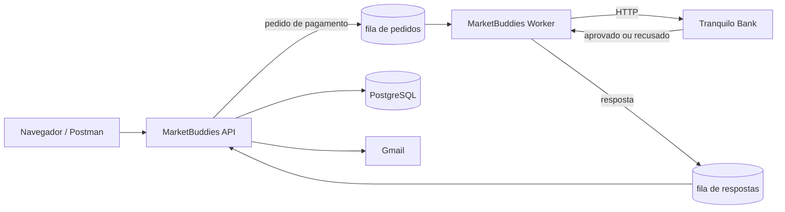

# MarketBuddies — CheckPoint 5 | Java Advanced

Mercado express com loja web autenticada (Spring Security + Thymeleaf + PostgreSQL) e pagamento assíncrono pelo **Tranquilo Bank** via RabbitMQ, com e-mail de confirmação e dashboard da gerência. Entrega única das Partes I e II do CheckPoint 5 da disciplina de Java Advanced (TDS) — FIAP.

> Em construção. As seções marcadas com _a preencher_ entram conforme a implementação avança.

---

## Deploy

| Recurso | URL |
|---------|-----|
| Aplicação (Railway) | _a preencher_ |
| Login | _a preencher_ |
| Painel do RabbitMQ | _a preencher_ |
| Vídeo | _a preencher_ |

> O deploy roda no plano de teste do Railway, que tem crédito limitado. Data estimada até quando os serviços ficam no ar: _a preencher após a medição de consumo_.

---

## Integrantes do Grupo

| Nome | RM |
|------|----|
| Felipe Yuiti Ishii | 565339 |
| Gabriel Nogueira Peixoto | 563925 |
| Giovanna Neri dos Santos | 566154 |
| Mariana Inoue | 565834 |

**Turma:** 2TDSR
**IDE utilizada:** IntelliJ IDEA

---

## Arquitetura

Três serviços Spring Boot no mesmo repositório, um para cada caixa do diagrama do enunciado (Back End API, Integração Pagamentos e API do Banco Tranquilo). A separação segue a demo de mensageria da disciplina (`demo-backend-api` + `demo-backend-worker`):



| Serviço | Pasta | Caixa do diagrama | Papel |
|---------|-------|-------------------|-------|
| MarketBuddies API | `marketbuddies-api/` | Back End API + Front end Web | Loja, login e cadastro, CRUD de produtos, carrinho, envio do pedido de pagamento, leitura das respostas, e-mail de confirmação, dashboard da gerência |
| MarketBuddies Worker | `marketbuddies-worker/` | Integração Pagamentos | Consome o pedido da fila, chama o Tranquilo Bank por HTTP e publica a resposta |
| Tranquilo Bank | `tranquilo-bank/` | API Plataforma de Pagamentos / Banco Tranquilo | API REST que aprova ou recusa o pagamento por uma regra fixa; não usa RabbitMQ nem banco de dados |

_Detalhes de exchanges, filas e mensagens: a preencher._

---

## Configuração do Projeto — Spring Initializr

Spring Boot 4.1.1, Java 21, Maven, configuração em YAML.

### MarketBuddies API


| Dependência | Categoria | Descrição |
|-------------|-----------|-----------|
| Spring Web | WEB | Camada MVC (controllers, dispatcher servlet) |
| Spring Security | SECURITY | Login customizado, cadastro, perfis e autorização por rota |
| Thymeleaf | TEMPLATE ENGINES | Telas renderizadas no servidor |
| Spring Data JPA | SQL | Persistência com JPA e Hibernate |
| PostgreSQL Driver | SQL | Driver JDBC do PostgreSQL |
| Validation | I/O | Bean Validation nos formulários |
| Lombok | DEVELOPER TOOLS | Redução de boilerplate |
| Spring Boot DevTools | DEVELOPER TOOLS | Reinício automático em desenvolvimento |
| Spring for RabbitMQ | MESSAGING | Envio do pedido de pagamento e leitura da resposta |
| Java Mail Sender | I/O | E-mail de confirmação de pagamento |

> Com Spring Security e Thymeleaf marcados, o Initializr inclui também `thymeleaf-extras-springsecurity6`, usado para mostrar ou esconder elementos por perfil nas telas.

### MarketBuddies Worker


| Dependência | Categoria | Descrição |
|-------------|-----------|-----------|
| Spring for RabbitMQ | MESSAGING | Consome os pedidos e publica as respostas |
| HTTP Client | WEB | `RestClient` para chamar o Tranquilo Bank, sem subir servidor web |
| Lombok | DEVELOPER TOOLS | Redução de boilerplate |
| Spring Boot DevTools | DEVELOPER TOOLS | Reinício automático em desenvolvimento |

### Tranquilo Bank


| Dependência | Categoria | Descrição |
|-------------|-----------|-----------|
| Spring Web | WEB | API REST de pagamentos |
| Validation | I/O | Validação da requisição de pagamento |
| Lombok | DEVELOPER TOOLS | Redução de boilerplate |
| Spring Boot DevTools | DEVELOPER TOOLS | Reinício automático em desenvolvimento |

---

## Estrutura do Projeto

```
cp5-market-buddies/
├── marketbuddies-api/      # loja web + back end (Spring MVC + Security + Thymeleaf + JPA)
├── marketbuddies-worker/   # integração de pagamentos (RabbitMQ + RestClient)
├── tranquilo-bank/         # API do banco (Spring Web)
├── docker-compose.yml      # PostgreSQL + RabbitMQ para rodar local
├── postman/                # coleção com as requisições de compra
├── assets/                 # imagens deste README
├── design/                 # design system e logos do MarketBuddies
└── integrantes.txt
```

_Árvore comentada de cada serviço: a preencher._

---

## Como Executar

### Pré-requisitos

- Java 21+
- Docker (para PostgreSQL e RabbitMQ)

### Rodando localmente

```bash
# Clonar o repositório
git clone https://github.com/3BugBuddies/cp5-market-buddies.git
cd cp5-market-buddies

# Subir PostgreSQL e RabbitMQ
docker compose up -d
```

Depois, rodar pela IDE `MarketbuddiesApiApplication`, `MarketbuddiesWorkerApplication` e `TranquiloBankApplication`.

| Recurso local | Endereço |
|---------------|----------|
| MarketBuddies API | http://localhost:8080 |
| Tranquilo Bank | http://localhost:8090 |
| MarketBuddies Worker | sem porta (só fila e HTTP de saída) |
| Painel do RabbitMQ | http://localhost:15672 (guest / guest) |
| PostgreSQL | `localhost:5432`, banco `marketbuddies` |

---

## Segurança — Spring Security

_A preencher: rotas × perfis (visitante, CLIENTE, ADMIN), login customizado, cadastro, redirecionamento por perfil, página 403._

---

## Mensageria — RabbitMQ

_A preencher: exchanges, filas, routing keys, formato das mensagens, regra de aprovação do Tranquilo Bank, prints do painel._

---

## E-mail de Confirmação

_A preencher: envio pelo Gmail, registro de cada e-mail no PostgreSQL, prints._

---

## Variáveis de Ambiente

Nenhuma senha fica no repositório. Cada `application.yaml` lê as configurações no formato `${VARIAVEL:padrão}`: o padrão é o ambiente local do `docker-compose.yml`, e no Railway as variáveis são cadastradas em cada serviço.

### MarketBuddies API

| Variável | Padrão local | Descrição |
|----------|--------------|-----------|
| `DB_URL` | `jdbc:postgresql://localhost:5432/marketbuddies` | URL JDBC do PostgreSQL |
| `DB_USER` | `marketbuddies` | Usuário do banco |
| `DB_PASSWORD` | `marketbuddies` | Senha do banco |
| `DDL_AUTO` | `update` | Estratégia do Hibernate para o schema |
| `SHOW_SQL` | `false` | Mostra o SQL no log |
| `RABBITMQ_HOST` | `localhost` | Host do RabbitMQ |
| `RABBITMQ_PORT` | `5672` | Porta AMQP |
| `RABBITMQ_USER` | `guest` | Usuário do RabbitMQ |
| `RABBITMQ_PASSWORD` | `guest` | Senha do RabbitMQ |
| `MAIL_HOST` | `smtp.gmail.com` | Servidor SMTP |
| `MAIL_PORT` | `587` | Porta SMTP (STARTTLS) |
| `MAIL_USERNAME` | — | Conta Gmail que envia as confirmações |
| `MAIL_PASSWORD` | — | Senha de app do Gmail (exige verificação em duas etapas) |
| `PORT` | `8080` | Porta HTTP (o Railway injeta a dele) |

### MarketBuddies Worker

| Variável | Padrão local | Descrição |
|----------|--------------|-----------|
| `RABBITMQ_HOST` | `localhost` | Host do RabbitMQ |
| `RABBITMQ_PORT` | `5672` | Porta AMQP |
| `RABBITMQ_USER` | `guest` | Usuário do RabbitMQ |
| `RABBITMQ_PASSWORD` | `guest` | Senha do RabbitMQ |
| `TRANQUILO_BANK_URL` | `http://localhost:8090` | Endereço da API do Tranquilo Bank |

### Tranquilo Bank

| Variável | Padrão local | Descrição |
|----------|--------------|-----------|
| `PORT` | `8090` | Porta HTTP |

---

## Credenciais de Teste

| Perfil | E-mail | Senha |
|--------|--------|-------|
| ADMIN | _a preencher_ | _a preencher_ |
| CLIENTE | _a preencher_ | _a preencher_ |

---

## Deploy no Railway

_A preencher: projeto com PostgreSQL, RabbitMQ (com painel de gerenciamento) e os três serviços deste repositório, cada um com a sua pasta como diretório raiz._

---

## Modelo de Dados

_A preencher: diagrama, campos por tabela, print do banco._

---

## Fluxo de Telas

_A preencher._

---

## Demonstração Visual

_A preencher: prints na ordem do fluxo no navegador, com destaque para o login e o cadastro._

---

## Testes com Postman

_A preencher: coleção em `postman/`, compra aprovada e compra recusada._

---

## Dashboard da Gerência

_A preencher._

---

## Tecnologias Utilizadas

- **Java 21**
- **Spring Boot 4.1.1**
- **Spring Web (MVC) + Thymeleaf**
- **Spring Security**
- **Spring Data JPA + Hibernate**
- **PostgreSQL**
- **Spring for RabbitMQ**
- **Java Mail Sender**
- **Lombok**
- **Docker** e **Railway**
- **Maven**
